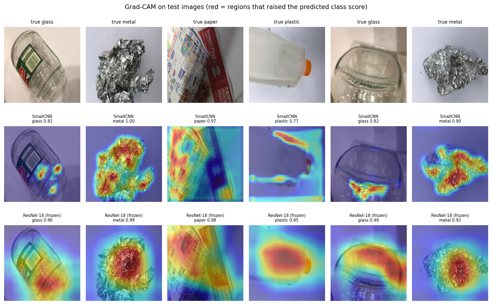

# Waste image classification
[](https://github.com/maryam843/waste-image-classification/actions/workflows/ci.yml)

A PyTorch comparison of my original fully connected network, a small CNN and a frozen ResNet-18 for sorting photos of
glass, metal, paper and plastic, using a leakage-safe protocol and Grad-CAM heat maps.

## Key results

- **Frozen ResNet-18:** 0.843 +/- 0.007 test accuracy (macro F1 0.841 +/- 0.007) on 298 TrashNet test photos, against
  0.510 for logistic regression on pixels and 0.299 for always guessing the majority class.
- **SmallCNN vs fully connected network:** the SmallCNN (389,924 parameters) scores 0.780 +/- 0.005, the fully connected
  network (77,237,380 parameters) scores 0.664 +/- 0.012. The CNN wins on every seed, and an exact McNemar test on the
  same test photos finds the gap significant on all 3 seeds.
- **ResNet-18 vs SmallCNN is only borderline:** the same McNemar test finds that gap significant on 2 of 3 seeds, not on
  the third, so the ResNet-18 lead is not a firm result.
- All numbers: mean +/- sd over 3 seeds, one full run on a T4 GPU in Google Colab, saved in `results/results.json`.

## Demo and visual

**Live demo:** [Hugging Face Space](https://huggingface.co/spaces/Maryamdafc/waste-image-classification) (Gradio).
Upload a JPEG or PNG photo of one item and get the top 3 classes with a Grad-CAM heat map. The demo model is the
ResNet-18 from seed 0, picked by the highest validation macro F1 (recorded under `demo_model` in `results/results.json`).



Red areas raised the predicted class score. The ResNet-18 tends to look at the object; the SmallCNN sometimes uses edges.

**Tools:** Python, PyTorch, torchvision, scikit-learn, NumPy, Pillow, Matplotlib, Gradio, Hugging Face Spaces, Google Colab, pytest, GitHub Actions

## Data

- **Source:** [TrashNet](https://github.com/garythung/trashnet) by Gary Thung and Mindy Yang, MIT licence.
- **Size:** the `dataset-resized.zip` file (42.8 MB, 512x384 JPEG photos). Of its 6 classes, 4 are used: glass, metal,
  paper and plastic (1,987 photos). Cardboard and trash are left out.
- **Cleaning:** every photo is hashed. Three photos appear twice under different labels (for example the same file in
  `glass/` and `plastic/`), so all 6 copies are dropped, leaving 1,981 photos.
- **Split:** stratified 70/15/15 on unique image hashes with seed 42: 1,386 train, 297 validation, 298 test. The split is
  committed as a CSV of hashes and labels only, no images: [`data_split/trashnet_split.csv`](data_split/trashnet_split.csv).
- **Not in this repo:** the images belong to the TrashNet authors and are not redistributed here (figures show a few test
  photos with the citation below).
- **How to get it:** `python -m waste_cls.cli prepare-data` downloads the zip from the TrashNet repository at a pinned
  commit, checks its SHA-256 and fails if the rebuilt split differs from the committed CSV.

## Approach

1. **Fixed data:** pinned TrashNet download, hash-based de-duplication and a committed split, the same on every run.
2. **Same input for every network:** photos resized to 224x224 and normalised with ImageNet statistics.
3. **Baselines first:** majority class, and logistic regression on 64x64 pixels with C chosen on validation, to see what
   a network has to beat.
4. **Three networks:** my original fully connected network [512,256,128] with BatchNorm and Dropout, unchanged; a
   SmallCNN with 4 conv blocks trained from scratch with light augmentation; and an ImageNet ResNet-18 with a frozen
   backbone and a new linear head (2,052 trainable parameters).
5. **Validation-only choices:** Adam (learning rate 1e-3), ReduceLROnPlateau, early stopping and the saved checkpoint
   all use validation macro F1. `train_model()` does not accept a test loader, and tests check this.
6. **Scoring:** 3 seeds per network, each trained model scored on the test set once; 95 % Wilson intervals and
   exact McNemar tests (`scripts/mcnemar.py`) on the shared test photos.
7. **Explanations:** Grad-CAM for the SmallCNN and the ResNet-18, plus galleries of misclassified test photos.

Design choices and the reason for each are in [`docs/DECISIONS.md`](docs/DECISIONS.md).

## Results

<!-- RESULTS:START -->
| Model | Test accuracy | Test macro F1 | 95 % Wilson CI for accuracy | Parameters (trainable) | Train time per run |
|---|---|---|---|---|---|
| Majority class | 0.299 | 0.115 | 0.250 to 0.353 | n/a | n/a |
| Logistic regression, 64x64 pixels | 0.510 | 0.493 | 0.454 to 0.566 | n/a | n/a |
| DNN [512,256,128] (original network) | 0.664 +/- 0.012 | 0.650 +/- 0.012 | 0.595 to 0.725 (widest over seeds) | 77,237,380 (77,237,380) | 81 s |
| SmallCNN (from scratch) | 0.780 +/- 0.005 | 0.775 +/- 0.005 | 0.724 to 0.828 (widest over seeds) | 389,924 (389,924) | 243 s |
| ResNet-18, frozen backbone (reference) | 0.843 +/- 0.007 | 0.841 +/- 0.007 | 0.789 to 0.885 (widest over seeds) | 11,178,564 (2,052) | 139 s |

Test set: 298 images. Networks: mean +/- sd over seeds 0, 1, 2. GPU: Tesla T4. Split hash: `479be6bb4d52`.

Run environment (recorded in results.json): Python 3.13.15, torch 2.11.0+cu128, torchvision 0.26.0+cu128.
<!-- RESULTS:END -->

The table is generated from `results/results.json` and checked in CI by `scripts/check_readme_claims.py`. The DNN row
is my original fully connected network. 99.8 % of its parameters sit in the first layer, because flattening a 224x224
photo gives 150,528 inputs. The executed notebook is
[`notebooks/waste_classification_executed.ipynb`](notebooks/waste_classification_executed.ipynb). More figures are in
[`figures/`](figures/): learning curves, confusion matrices, a results bar chart and misclassified photos per model.

## Limitations

- Trained on TrashNet studio photos (single item, plain background); not reliable on real bins or cluttered photos.
  Only 4 materials are covered.
- 298 test photos leave a few points of uncertainty, and the ResNet-18 vs SmallCNN gap is borderline. De-duplication
  uses exact hashes only, so about 7 test photos have a near-identical twin in train or validation.
- The comparison is not fully matched: augmentation is on for the two CNNs and off for the fully connected network, and
  the SmallCNN's best epoch was close to the 40-epoch cap on every seed, so it was probably still improving.
- The ResNet-18 backbone is frozen (only the head is trained); fine-tuning is not tested. The reported run used Colab's
  Python and PyTorch versions, not the pinned versions CI tests on, and GPU runs can differ slightly between repeats.

## How to run

Local setup, tests and a smoke run on tiny synthetic images (CPU; the smoke run itself takes about 10 s):

<!-- readme-commands -->
```bash
python -m venv .venv
source .venv/bin/activate            # Windows: .venv\Scripts\activate
pip install torch==2.14.0 torchvision==0.29.0 --index-url https://download.pytorch.org/whl/cpu   # Linux, CPU only
pip install -r requirements-dev.txt
pip install -e . --no-deps
pytest
python -m waste_cls.cli run --config smoke --out runs/smoke
python scripts/pii_scan.py
python scripts/check_readme_claims.py
```

Tests and lint as CI runs them:

```bash
ruff check .
python -m pytest --cov --cov-report=term-missing --cov-fail-under=85
```

Full run (download TrashNet, train all models, write results, figures and the demo model; use a GPU):

```bash
python -m waste_cls.cli prepare-data
python -m waste_cls.cli run --config full --out results --figures figures --export exports/demo_model.pt
python -m waste_cls.cli predict --model exports/demo_model.pt --image photo.jpg --cam cam.png
```

`predict` prints the top 3 classes for one photo and saves a Grad-CAM image. The same full run is a notebook:
[open `notebooks/waste_classification.ipynb` in Google Colab](https://colab.research.google.com/github/maryam843/waste-image-classification/blob/main/notebooks/waste_classification.ipynb), choose a T4 GPU runtime and run all cells.

## Repo structure

```text
src/waste_cls/       package: data, models, training, evaluation, Grad-CAM, plots, CLI
notebooks/           notebook (runs on Google Colab) and its executed copy
results/             results.json from the full run, plus its environment notes
figures/             learning curves, confusion matrices, Grad-CAM, error galleries, results bar chart
data_split/          committed train/validation/test split (hashes only)
hf_space/            Gradio app and setup notes for the Hugging Face Space
scripts/             README check, McNemar tests, personal data scan, Space build
tests/               pytest suite
docs/DECISIONS.md    design choices and reasons
.github/workflows/   CI (Ubuntu and Windows)
```

## Licence and credits

- Code: MIT licence, see [`LICENSE`](LICENSE).
- TrashNet dataset: Gary Thung and Mindy Yang, "Classification of Trash for Recyclability Status", 2016,
  [github.com/garythung/trashnet](https://github.com/garythung/trashnet), MIT licence. The images are not included;
  they keep their own licence.
- ResNet-18: He et al., "Deep Residual Learning for Image Recognition", 2016; ImageNet weights from torchvision.
- Grad-CAM: Selvaraju et al., "Grad-CAM: Visual Explanations from Deep Networks via Gradient-based Localization", 2017.
